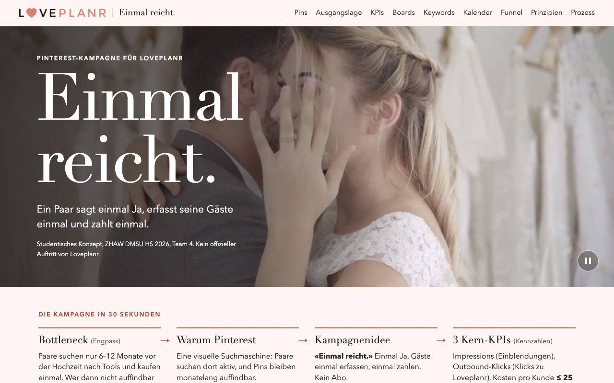

# Einmal reicht.

**Pinterest-Kampagne für das Schweizer Start-up Loveplanr.** Final Artefact im Kurs «Digital Marketing for Start-ups», ZHAW, HS 2026, Team 4.

**Live:** [löve.ch](https://löve.ch) · **Prozess und Dokumentation:** [löve.ch/prozess](https://xn--lve-sna.ch/prozess/) · **Alle Pins als CSV:** [`assets/pins/pin-set.csv`](assets/pins/pin-set.csv)

> Studentisches Projekt, kein offizieller Auftritt von Loveplanr. Fotos und Video sind lizenzierte Stock-Motive (Envato) und zeigen keine Kundenpaare. Laura, Marco und Peter sind fiktive Personas.



---

## Inhalt

1. [Auf einen Blick](#auf-einen-blick)
2. [Ausgangslage](#ausgangslage)
3. [Die Kampagnenidee](#die-kampagnenidee)
4. [Was die Website zeigt](#was-die-website-zeigt)
5. [Die Pins](#die-pins)
6. [Verhaltensprinzipien](#verhaltensprinzipien)
7. [Wie das Artefakt mit KI entstanden ist](#wie-das-artefakt-mit-ki-entstanden-ist)
8. [Iterationen](#iterationen)
9. [Qualität und Technik](#qualität-und-technik)
10. [Aufbau des Repos](#aufbau-des-repos)
11. [Lokal ausführen](#lokal-ausführen)
12. [Quellen, Rechte und Grenzen](#quellen-rechte-und-grenzen)

---

## Auf einen Blick

| | |
|---|---|
| **Start-up** | [Loveplanr](https://loveplanr.com): Plattform für Hochzeitspaare im DACH-Raum mit Hochzeitswebseite, Rückmeldungen (RSVP), Gästeliste, Sitzplan und weiteren Tools |
| **USP** | Einmaliger Preis statt Abo: CHF 149 (Webseite) oder CHF 249 (Komplettpaket), kostenlos starten |
| **Engpass im Funnel** | Reach und Awareness: Paare suchen nur in einem kurzen Planungsfenster nach Tools |
| **Kanal** | Pinterest als visuelle Suchmaschine, Instagram nur zum Wiederverwenden |
| **Idee** | «Einmal reicht.»: einmal Ja sagen, Gäste einmal erfassen, einmal zahlen |
| **Umfang** | 12 einplanbare Pins plus 1 Vorschlag, 3 Boards, Keywords, Kalender über 8 Wochen, Promoted-Test, Funnel |
| **Zielwert** | Kosten pro Kunde ≤ 25 CHF, Stopp über 30 CHF |
| **Werkzeug** | Claude Code (Claude Opus 5.5), jeder Prompt im Wortlaut dokumentiert |

## Ausgangslage

Loveplanr bündelt digitale Hochzeits-Tools auf einer Plattform und verkauft sie zum einmaligen Preis. Das Produkt steht. Das Problem liegt ganz oben im Funnel: Paare suchen nur während der Planung, nach Annahme des Teams etwa 6 bis 12 Monate vor der Hochzeit, nach solchen Tools, und sie kaufen einmal. Wer in diesem Fenster nicht auffindbar ist, verliert das Paar an Gratis-Tools oder an die Konkurrenz. Der bisherige Social-Media-Auftritt setzt auf Humor und transportiert das Wertversprechen kaum.

**Warum Pinterest:** Paare suchen dort aktiv nach Begriffen wie «Hochzeitswebseite erstellen» oder «Hochzeit Checkliste», und Pins bleiben über Monate auffindbar. Das passt zu einem Planungsfenster, das sich für jedes Paar neu öffnet.

**Zielgruppe:**
- **Käufer:** Laura (33) und Marco (31) aus Zürich, beide berufstätig, heiraten in 6 bis 12 Monaten.
- **Gast mit Veto:** Peter (58), der Onkel der Braut, wenig techaffin. Er braucht einen Link, keine App und kein Konto.

## Die Kampagnenidee

**«Einmal reicht.»** leitet sich direkt aus dem USP ab und zieht sich als Motiv «1×» durch Pins und Website:

| 1× Ja sagen | 1× Gäste erfassen | 1× zahlen |
|---|---|---|
| Ihr heiratet einmal. Ein Abo passt nicht zu einem einmaligen Tag. | Die Gästeliste entsteht einmal und läuft weiter in Rückmeldungen und Sitzplan. | CHF 149 oder CHF 249, einmalig inkl. MwSt. Ohne Abo und ohne monatliche Kosten. |

Die Boards folgen dem Modell **Hero, Hub, Help**:
- **Help** liefert Antworten auf konkrete Suchen und hält die Kampagne am Leben. Diese Pins starten darum zuerst.
- **Hero** setzt die Lancierung mit der Kernbotschaft.
- **Hub** bringt echte Stimmen von Paaren.

## Was die Website zeigt

| Nr. | Bereich | Inhalt |
|---|---|---|
| – | Zusammenfassung | Die Kampagne in 30 Sekunden: Engpass, Kanal, Idee, Kern-KPIs |
| 1 | [Pin-Set](https://xn--lve-sna.ch/#pins) | 12 Pins im Masonry-Raster, filterbar nach Board, je mit Prinzip, Beschreibung und Keywords. Mockup eines Suchresultats |
| 2 | [Ausgangslage](https://xn--lve-sna.ch/#ausgangslage) | Start-up, Engpass, Planungsfenster, Kampagnenziel, Personas |
| 3 | [KPIs](https://xn--lve-sna.ch/#kpi) | Fünf Kennzahlen von Impressions bis Kosten pro Kunde, mit Quelle und Zielwert |
| 4 | [Boards](https://xn--lve-sna.ch/#boards) | Hero, Hub und Help mit Rolle und Pins |
| 5 | [Keywords](https://xn--lve-sna.ch/#keywords) | Suchbegriffe in fünf Gruppen, und wo sie im Pin stehen |
| 6 | [Kalender](https://xn--lve-sna.ch/#kalender) | Acht Wochen Content-Plan und ein kleiner Promoted-Pins-Test (Preis gegen Hilfe) |
| 7 | [Funnel](https://xn--lve-sna.ch/#funnel) | «Ein Abend im Planungsfenster» und die Zielseite jedes Pins mit UTM-Schema |
| 8 | [Prinzipien](https://xn--lve-sna.ch/#prinzipien) | Fünf eingesetzte Verhaltensprinzipien, zwei bewusst weggelassen |
| – | [Prozess](https://xn--lve-sna.ch/prozess/) | Stand der Pins, offene Punkte, Prompt-Log, AI-Fehler, Quellen |

## Die Pins

Format 2:3 (1000 × 1500 px), Deutsch, Schweizer Rechtschreibung. Das Keyword steht vorne im Titel, weil Pinterest im Feed oft nur die ersten rund 40 Zeichen zeigt. Ein Klick auf die Nummer öffnet den Pin in voller Grösse.

| Pin | Board | Titel | Prinzip und Element | Zielseite | Stand |
|---|---|---|---|---|---|
| [01](assets/pins/01-einmal-ja.jpg) | Hero | Hochzeitswebseite ohne Abo: einmal Ja, einmal zahlen | **Commitment & Consistency**: Beschreibung «Kostenlos ausprobieren» | `loveplanr.com/preise/` | bereit |
| [02](assets/pins/02-einmal-reicht.jpg) | Hero | Hochzeit an einem Ort planen: Gäste nur einmal erfassen | **Social Proof**: Hinweis «Bereits von 10’000+ Hochzeitspaaren genutzt» | `loveplanr.com/komplettpaket/` | Freigabe für Pinterest offen |
| [03](assets/pins/03-mehr-vorfreude.jpg) | Hero | Hochzeitswebseite kostenlos erstellen, Paket erst später wählen | **Commitment & Consistency**: Zeile «Paket erst später wählen» | `app.loveplanr.com/de/sign-up` | bereit |
| [04](assets/pins/04-melek-rafael.jpg) | Hub | Sitzplan Hochzeit: Gäste nicht nochmals erfassen, sagen Melek & Rafael | **Social Proof**: Zitat von Melek & Rafael | `loveplanr.com/sitzplan/` | Freigabe für Pinterest offen |
| [05](assets/pins/05-aline-josia.jpg) | Hub | Hochzeitswebseite schnell erstellt: die Erfahrung von Aline & Josia | **Social Proof**: Zitat von Aline & Josia | `loveplanr.com/hochzeitswebsite/` | Freigabe für Pinterest offen |
| [06](assets/pins/06-feierabend.jpg) | Hub | Hochzeit planen ohne Excel: Webseite und Gäste an einem Ort | **Liking**: Augenzwinkern in «Feierabend statt Excel-Abend» | `loveplanr.com/hochzeitswebsite/` | Freigabe für Pinterest offen |
| [07](assets/pins/07-partner.jpg) | Hub | Hochzeit Dienstleister: ausgewählte Partner für euren grossen Tag | **Authority**: Verweis auf die Partner von Loveplanr | `loveplanr.com/partner/` | Startfassung: echtes Material ersetzt sie später |
| [08](assets/pins/08-gratis-checkliste.jpg) | Help | Gratis Hochzeits-Checkliste zum Herunterladen | **Reciprocity**: CTA «Gratis Hochzeits-Checkliste» | `loveplanr.com/hochzeitscheckliste/` | Vorschlag: neue Zielseite nötig |
| [09](assets/pins/09-fuenf-schritte.jpg) | Help | Hochzeitswebseite erstellen: Anleitung in 5 Schritten | **Reciprocity**: Anleitung in 5 Schritten, ohne Gegenleistung | `loveplanr.com/hochzeitswebsite/` | bereit |
| [10](assets/pins/10-rueckmeldungen.jpg) | Help | Hochzeit RSVP: Zu- und Absagen online sammeln statt im Gruppenchat | **Liking**: gemeinsames Ärgernis «Zusagen im Gruppenchat» | `loveplanr.com/rueckmeldung/` | bereit |
| [11](assets/pins/11-sitzplan.jpg) | Help | Sitzplan Hochzeit erstellen, ohne die Gäste nochmals zu erfassen | **Commitment & Consistency**: Zeile «Gäste einmal erfassen, im Sitzplan weiterverwenden» | `loveplanr.com/sitzplan/` | bereit |
| [12](assets/pins/12-onkel-peter.jpg) | Help | Hochzeitsfotos von Gästen sammeln: ohne App, ohne Registrierung | **Liking**: Figur «Onkel Peter» | `loveplanr.com/gaestefotos/` | bereit |
| [13](assets/pins/13-sabine-markus.jpg) | Hub | Hochzeit RSVP: alle Rückmeldungen übersichtlich, sagen Sabine & Markus | **Social Proof**: Zitat von Sabine & Markus | `loveplanr.com/rueckmeldung/` | Freigabe für Pinterest offen |

Alle Links tragen das UTM-Schema `utm_source=pinterest&utm_medium=organic&utm_campaign=einmal-reicht&utm_content=<pin-id>`. Promoted-Pins erhalten `utm_medium=paid`.

## Verhaltensprinzipien

Jedes Prinzip ist an einem konkreten Element sichtbar, auf dem Pin und auf der Website im Bereich 8.

| Prinzip | Wo es sichtbar ist |
|---|---|
| **Reciprocity** (Gegenseitigkeit) | Pin 09 gibt eine Anleitung ohne Gegenleistung. Pin 08 bietet eine Checkliste gegen die E-Mail-Adresse (Vorschlag, braucht neue Zielseite) |
| **Commitment & Consistency** (Selbstbindung) | Kostenlos erstellen und testen, Paket erst später wählen (Pins 01, 03, 11) |
| **Social Proof** (Orientierung an anderen) | «Bereits von 10’000+ Hochzeitspaaren genutzt» und wörtliche Zitate von Paaren (Pins 02, 04, 05, 13) |
| **Authority** (Autorität) | Verweis auf die Partner von Loveplanr (Pin 07). Nächster Schritt: Empfehlung einer Hochzeitsplanerin |
| **Liking** (Sympathie) | Augenzwinkern und Alltagsärger (Pins 06, 10), Figur «Onkel Peter» (Pin 12) |
| ~~Scarcity~~ | Bewusst weggelassen: Pins leben Monate, «nur heute» wäre bald falsch |
| ~~Unity~~ | Bewusst weggelassen: Ausser dem Heiraten teilen die Paare keine Identität |

## Wie das Artefakt mit KI entstanden ist

Die Website, die Pins und die Dokumentation sind mit **Claude Code** entstanden. Das Team hat die Prompts geschrieben, jede Fassung auf Desktop und Handy geprüft und korrigiert. Drei Regeln galten durchgehend:

1. **Jede Prompt-Iteration ist ein eigener Commit.** Die Git-Historie belegt den Verlauf.
2. **Jeder Prompt steht im Wortlaut** in [`docs/prompt-log.md`](docs/prompt-log.md), Tippfehler inklusive. Nur private Angaben sind geschwärzt.
3. **Echte Fehler der KI** stehen in [`docs/ai-fehler.md`](docs/ai-fehler.md): Output, wie der Fehler bemerkt wurde, wie er korrigiert wurde. Teil B hält fest, wo sich Vorgaben als ungenau erwiesen.

Dazu kommen feste Inhaltsregeln: keine erfundenen Zahlen, keine erfundenen Zitate, Stock-Fotos nie als Kundenpaare. Was fehlt, steht als offener Punkt in [`docs/offene-punkte.md`](docs/offene-punkte.md). Quellen und Annahmen stehen in [`docs/quellen-und-platzhalter.md`](docs/quellen-und-platzhalter.md). Vorher- und Nachher-Screenshots der Iterationen liegen in [`docs/iterationen/`](docs/iterationen/).

## Iterationen

| Iteration | Commit | Was verlangt und geändert wurde |
|---|---|---|
| Einrichtung | `4925004` bis `fc8a485` | Repo, GitHub Pages, privates Material ausgeschlossen, Domain löve.ch verbunden |
| 1 | `eb50468` | Kampagnenidee «Einmal reicht.», Pin-Generator, Website mit acht Bereichen, Dokumentation |
| 2 | `d007ae1` | Platzhalter-Pins durch gestaltete Hub-Pins mit neuen Fotos ersetzt |
| 3 | `e425332` | Echte Zitate von Paaren wörtlich von loveplanr.com auf die Hub-Pins |
| 4 | `41820a5` | Aussage «Bereits von 10’000+ Hochzeitspaaren genutzt» auf Pin 02 |
| 5 | `1464982` | Rollen-Prompt: Widersprüche behoben, Pins ins Zentrum, Prozess auf eigene Unterseite |
| 6 | `7d8beb0`, `54aac6f` | Originallogo von Loveplanr, Hintergrundvideo im Hero (Ring-Clip) |
| 7 | `09589d1` | Ladezeit und SEO auf 100, Sitemap, Indexierung |

## Qualität und Technik

**Lighthouse 12.6.1, Live-Seite, 14.11.2026:**

| Seite | Gerät | Leistung | Barrierefreiheit | Best Practices | SEO |
|---|---|---|---|---|---|
| Start | Handy | 100 | 100 | 100 | 100 |
| Start | Desktop | 100 | 100 | 100 | 100 |
| Prozess | Handy | 100 | 100 | 100 | 100 |
| Prozess | Desktop | 100 | 100 | 100 | 100 |

**Umgesetzt:**
- Statisches HTML und CSS, ohne Framework und ohne Build-Schritt im Browser. Schriften sind Systemschriften.
- Bilder als WebP mit `srcset` und `loading="lazy"`, feste Breiten und Höhen gegen Layout-Sprünge.
- Hintergrundvideo: stumm, zwei Grössen (1280 px und 720 px), startet erst nach dem Laden der Seite, pausiert ausserhalb des Bildschirms. Pause-Knopf nach WCAG 2.2.2. Bei «Bewegung reduzieren» und im Datensparmodus bleibt das Standbild.
- Barrierefreiheit: Sprunglink, sichtbarer Fokus, Alt-Texte, Tabellen werden auf dem Handy zu Karten.
- Suche: `canonical`, strukturierte Daten (WebSite), `robots.txt`, `sitemap.xml`, `llms.txt` für KI-Agenten, Meldung an IndexNow.
- Hosting: GitHub Pages mit eigener Domain und HTTPS.

## Aufbau des Repos

```
├── index.html               Startseite (Pin-Karten, Mockup und Funnel werden eingefügt)
├── prozess/index.html       Unterseite, aus docs/ erzeugt
├── assets/
│   ├── site.css             gesamtes Design
│   ├── img/                 Website-Bilder (WebP) und Logo
│   ├── video/               Hero-Video in zwei Grössen und Standbilder
│   └── pins/                Pins in voller Grösse (JPG), Vorschauen (WebP), pin-set.csv
├── tools/
│   ├── pins_data.py         Texte aller Pins: eine Quelle für Bilder, CSV und Website
│   ├── make_pins.py         rendert die Pins (braucht die lokalen Originalfotos und Chrome)
│   ├── make_webp.cjs        erzeugt WebP-Varianten (npm-Paket sharp)
│   └── build_site.py        schreibt Pins in index.html und erzeugt prozess/
├── docs/                    Prompt-Log, AI-Fehler, offene Punkte, Quellen, Screenshots
├── robots.txt, sitemap.xml, llms.txt
└── CNAME                    löve.ch (xn--lve-sna.ch)
```

Nicht im Repo: die Originalfotos in voller Auflösung (Lizenz), die Projektvorgaben und das Kursmaterial (privat).

## Lokal ausführen

```bash
git clone https://github.com/ybenb/loveplanr-kampagne.git
cd loveplanr-kampagne
python3 -m http.server 8765      # dann http://localhost:8765 öffnen
```

Pins ändern: nur in `tools/pins_data.py`, danach

```bash
python3 -I tools/make_pins.py    # braucht die lokalen Originalfotos
node tools/make_webp.cjs         # braucht sharp
python3 -I tools/build_site.py
```

## Quellen, Rechte und Grenzen

- **Produktangaben, Preise, Zitate und die Nutzerzahl** stammen wörtlich von [loveplanr.com](https://loveplanr.com), geprüft am 04. und 05.11.2026. Ob Zitate und Nutzerzahl auf Pinterest erscheinen dürfen, müssen Gründer und Paare noch freigeben. Bis dahin gehen die betroffenen Pins nicht online.
- **Logo:** Die Wortmarke in der Kopfzeile ist die Originaldatei von loveplanr.com. Die Pins tragen noch eine Rekonstruktion.
- **Fotos und Video:** Stock-Motive über Envato lizenziert. Sie zeigen keine Kundenpaare, auch nicht auf den Pins mit Zitaten.
- **Annahmen des Teams** sind als solche gekennzeichnet, zum Beispiel das Planungsfenster von 6 bis 12 Monaten. Die Website zeigt kein Suchvolumen und keine erfundenen Zielwerte. Vier KPIs erhalten ihre Basiswerte erst in den ersten vier Wochen.
- **Offen** sind unter anderem die Zielseite für die Checkliste (Pin 08), die Freigaben für Pinterest, Startdatum und Testbudget. Die vollständige Liste steht in [`docs/offene-punkte.md`](docs/offene-punkte.md).
